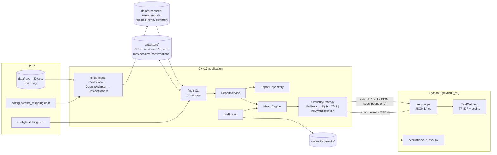
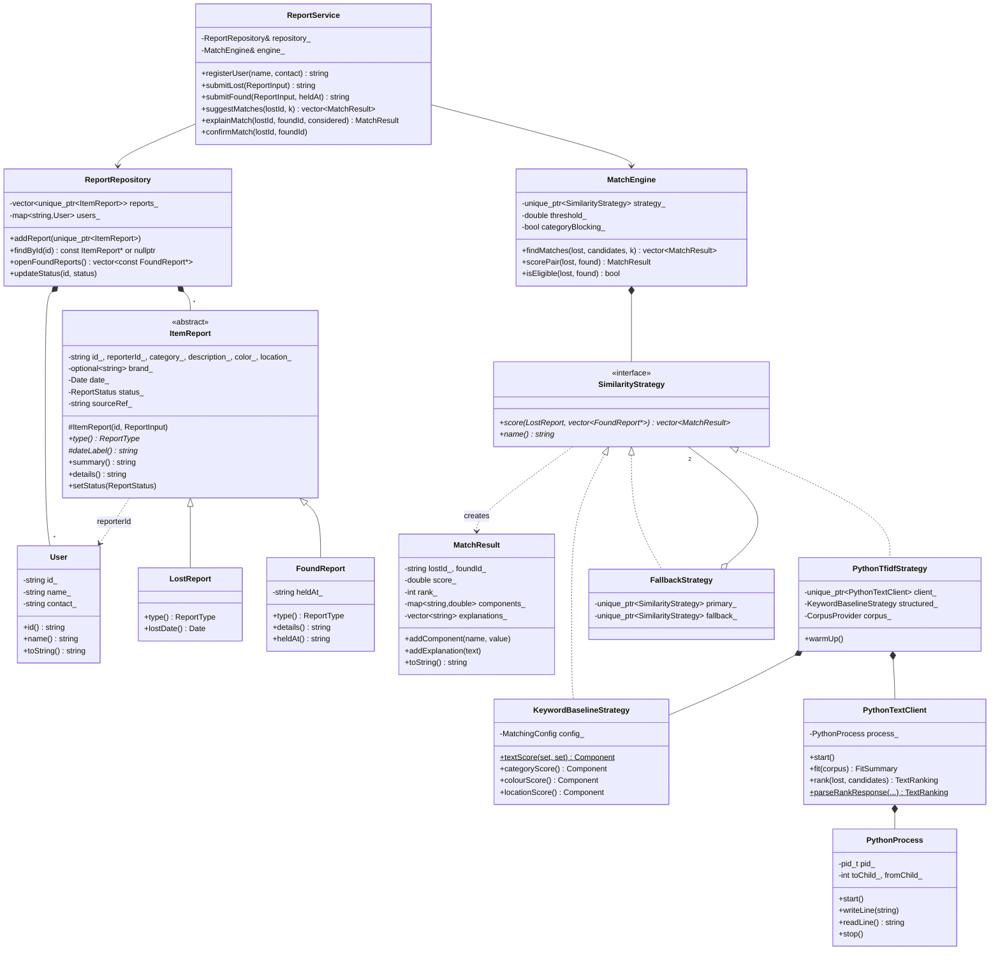
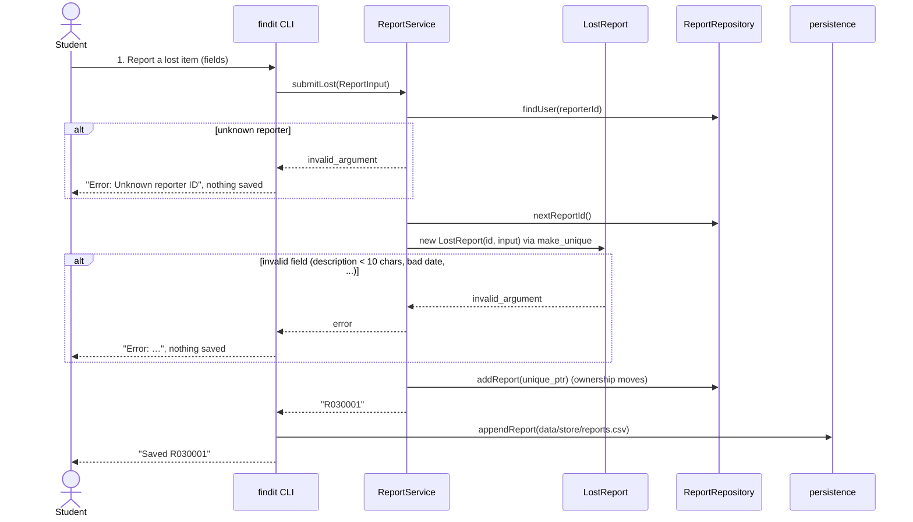
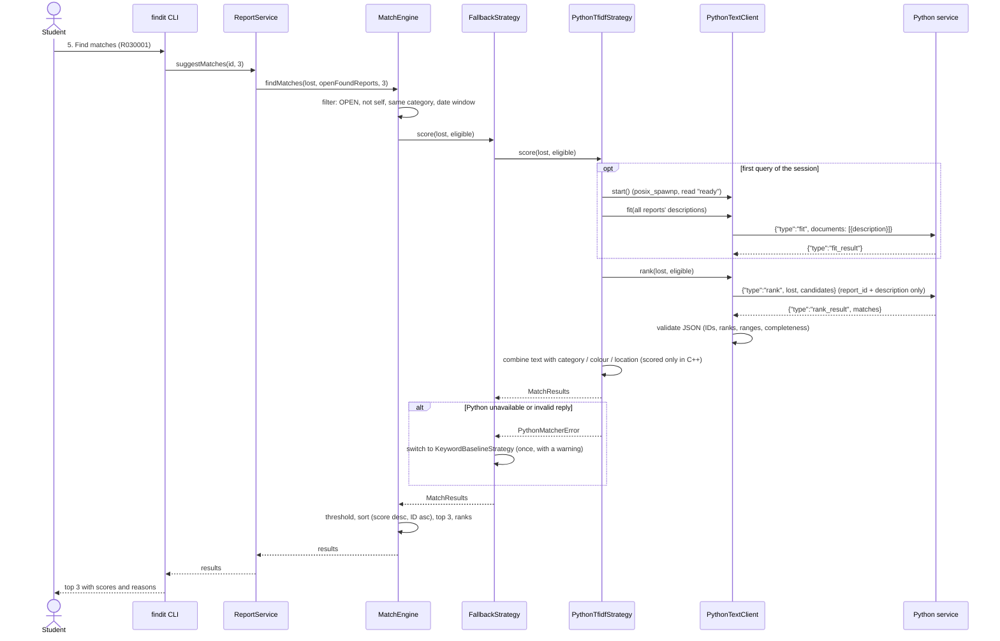
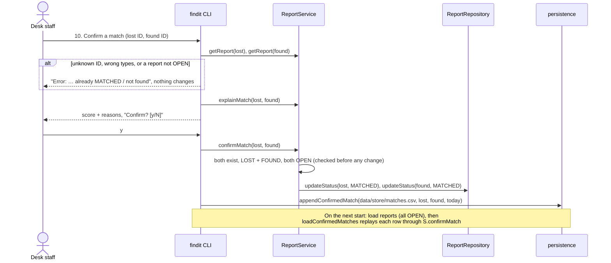

# Architecture

> **Previewing the diagrams.** GitHub renders these Mermaid blocks natively. In VS Code, install
> the "Markdown Preview Mermaid Support" extension (`bierner.markdown-mermaid`) and open the
> Markdown preview (Cmd+Shift+V). To render offline to SVG with the official CLI (checked with
> 11.4.2 against the installed Google Chrome; nothing is installed globally):
> ```sh
> mkdir -p /tmp/mmd && cd /tmp/mmd && PUPPETEER_SKIP_DOWNLOAD=1 npm install @mermaid-js/mermaid-cli@11.4.2
> echo '{"executablePath":"/Applications/Google Chrome.app/Contents/MacOS/Google Chrome"}' > p.json
> ./node_modules/.bin/mmdc -p p.json -i <project>/docs/ARCHITECTURE.md -o arch.md   # writes arch-1.svg … arch-5.svg
> ```

## System architecture



## Class diagram (core domain and matching)



The supporting classes (`Date`, `CsvReader`, `DatasetConfig`, `DatasetAdapter`, `DatasetLoader`,
`KeyValueConfig`, `MatchingConfig`, `persistence::*`) are left out to keep the diagram readable.
They are listed in [DESIGN.md](DESIGN.md).

## Sequence: submitting a report



## Sequence: retrieving matches



## Sequence: confirming a match (and restoring it after a restart)



Status rules: `OPEN → MATCHED` (confirmation, both reports together), `MATCHED → CLOSED` and
`OPEN → CLOSED` (allowed by the model, not in the menu). Nothing moves back to OPEN; enforced by
`ItemReport::setStatus`.
